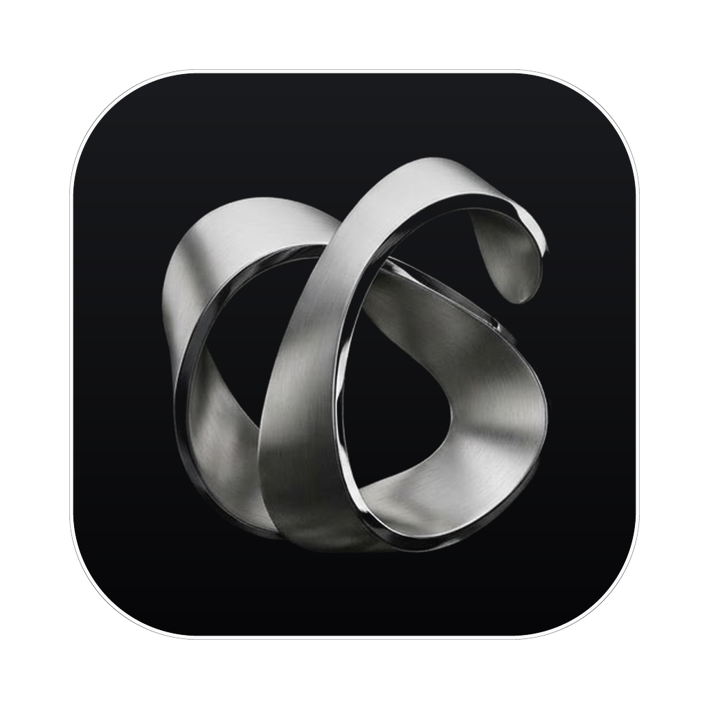
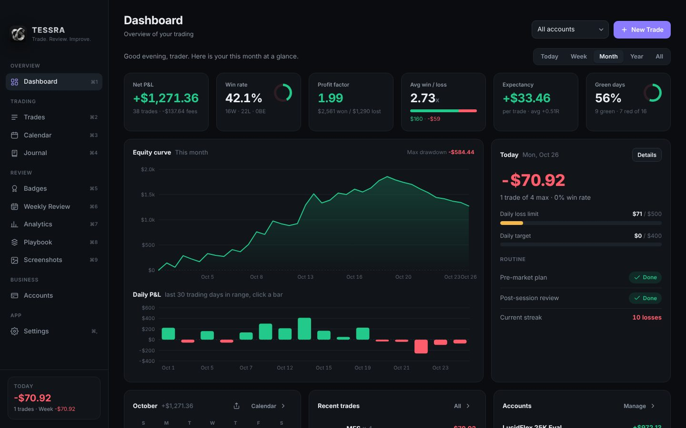
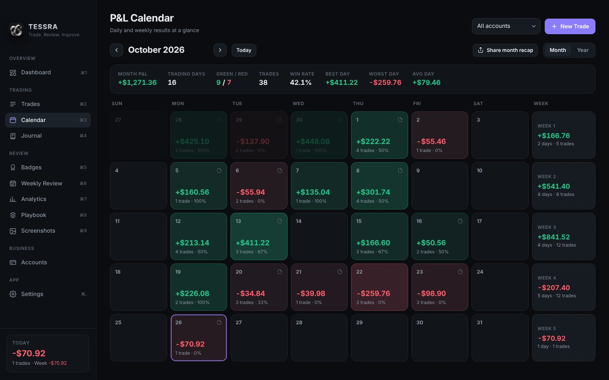
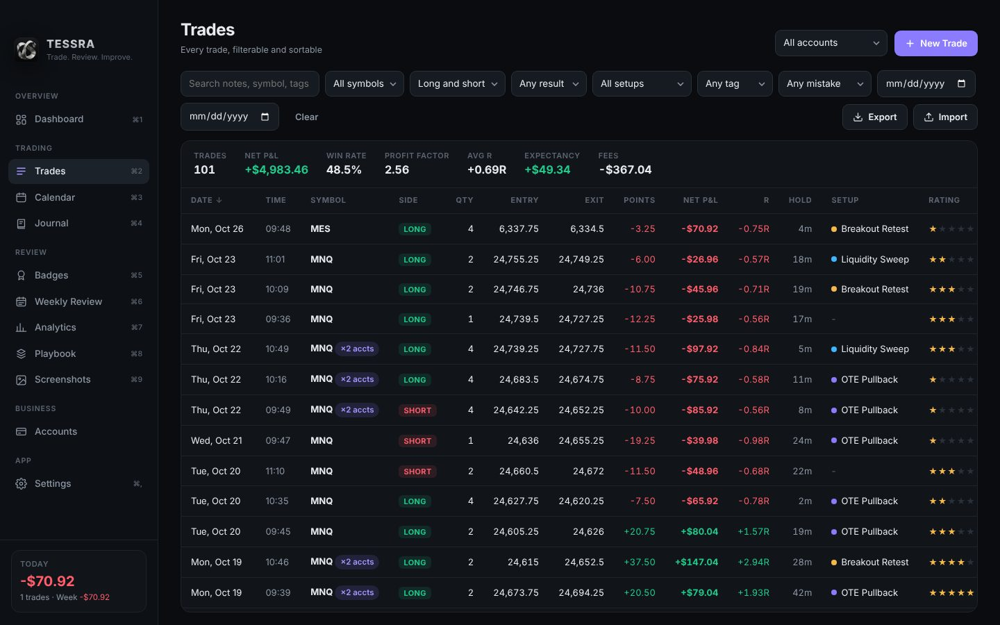
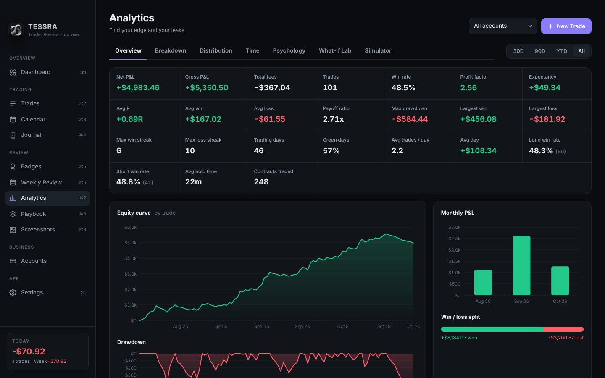
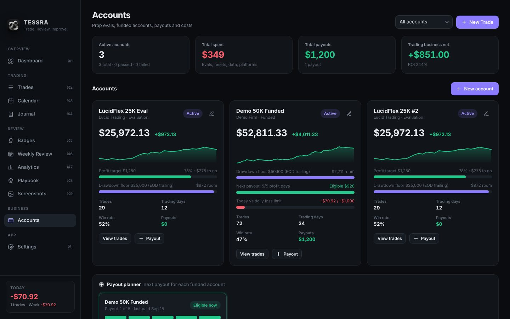
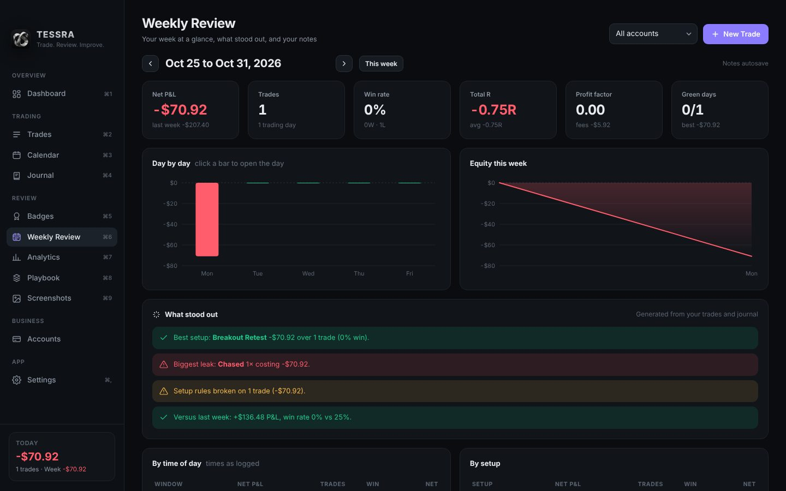
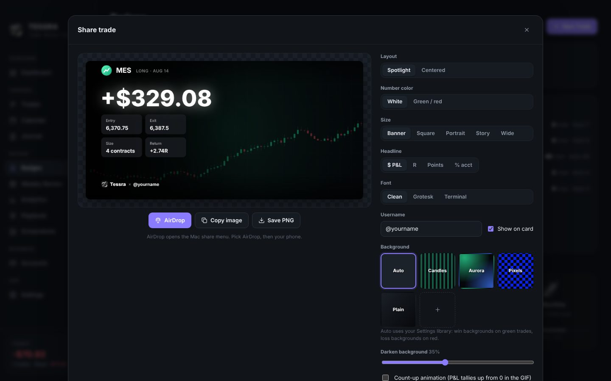

<p align="center"></p>
<h1 align="center">Tessra</h1>
<p align="center"><b>Trade. Review. Improve.</b><br>A free desktop trading journal for futures and prop firm traders. Everything stays on your computer.</p>

<p align="center"><a href="https://github.com/tatarigami22/tessra-journal/releases/latest"><b>Download the latest version</b></a></p>



## Download and install

Go to [Releases](https://github.com/tatarigami22/tessra-journal/releases/latest) and download the file for your computer:

| Computer | File |
| --- | --- |
| Mac with Apple Silicon (M1, M2, M3, M4) | `Tessra-x.x.x-mac-arm64.dmg` |
| Mac with Intel chip | `Tessra-x.x.x-mac-x64.dmg` |
| Windows 10 or 11 | `Tessra-Setup-x.x.x.exe` |

Not sure which Mac you have? Apple menu > About This Mac. "Chip: Apple M..." means Apple Silicon.

**Mac:** open the .dmg and drag Tessra into Applications. Tessra is not signed with a paid Apple developer certificate, so the first time you open it macOS will warn you. Right click Tessra in Applications and choose **Open**. If there is no Open button, go to **System Settings > Privacy & Security**, scroll down and click **Open Anyway**. You only do this once.

**Windows:** run the installer. If SmartScreen says "Windows protected your PC", click **More info > Run anyway**.

**Updates:** Tessra checks for a new release when it opens and shows an "Update available" button in the sidebar. Download the new version and install it over the old one. Your data is kept.

## Screenshots

| | |
| --- | --- |
|  |  |
|  |  |
|  |  |

## Features

- **Dashboard**: P&L, win rate, profit factor, expectancy, equity curve, daily bars, today vs your risk rules, mini calendar, recent trades, account progress, top setups, costliest mistakes.
- **Trades**: every trade with filters (symbol, side, result, setup, tag, mistake, dates, search) and sortable columns. Click a row for full details.
- **Calendar**: month view with daily P&L, weekly totals and month stats. Year view as a heatmap. Click any day.
- **Journal**: pre-market plan, bias, mood, sleep, key levels, post-session review, discipline score, followed-plan, screenshots. Autosaves.
- **Analytics**: overview stats, equity and drawdown, monthly P&L, breakdowns by setup, symbol, side, size, tag, account, weekday, hour, hold time, trade number of the day, R and P&L distributions, psychology (cost of mistakes, rule adherence, mood, discipline), and the What-if Lab (test rules like max trades per day, daily stops, time windows, setups only, fixed size, -1R cap and fixed R targets on your real trades), and the Simulator (reshuffles your real trades thousands of times to estimate eval pass and blow-up odds, days to pass and expected eval spend).
- **Weekly Review**: pick any week to see KPIs vs last week, day by day bars, auto insights (best and weakest setup, biggest leak, rule breaks, best time window, overtrading, revenge trades), plus your grade, lessons and a focus that carries into next week.
- **Badges**: weekly challenges, streaks (green days, rule-perfect trades, days within limits, journaling) and 22 achievements across milestones, streaks, discipline and prop goals.
- **Playbook**: your setups with rules. Rules become a checklist on every trade.
- **Screenshots**: gallery of every chart you saved.
- **Accounts**: prop evals and funded accounts with profit target progress, trailing drawdown room, daily loss limit, payouts, and a "trading business" net (payouts minus eval costs). Payout Planner tracks each funded account's profit days, withdrawable amount, your split and an estimated payout date (LucidFlex presets included).
- **Share cards**: open any trade, day, or month (Monthly Recap from the Calendar) and click Share. Pick size, headline ($, R, points, % of account), font and background, then AirDrop it to your phone, copy it, or save a PNG or animated GIF. Add your own image and GIF backgrounds in Settings > Share cards and tag them Wins, Losses or Any.
- **Copy trading**: tick the other accounts a trade was copied to; each account keeps its own balance and payouts, stats count it once in All accounts view, and edits sync across copies.
- **Daily lock**: hit your daily max loss (or optional profit target / max trades) and the app says you're done for the day; later trades get tagged "Traded after lock".
- **Tax records**: yearly payouts, split, expenses and live account P&L as a PDF or CSV (Accounts or Settings).
- **Settings**: risk rules, contract specs (point value and fees), tags, mistakes, CSV import, backups.

## Tips

- On Windows use Ctrl wherever you see ⌘.
- ⌘N new trade, ⌘1 to ⌘9 switch pages, Esc closes panels.
- Paste a screenshot straight from TradingView with ⌘V into an open trade or journal day.
- Import from Tradovate: Account Reports, Performance tab, export CSV, then Import in the app. Re-importing the same file skips trades you already have.
- Fees default from Settings > Contract specs (per contract, round trip). Change them to match your firm.
- Settings has "Load demo data" to explore and "Remove demo data" to clear it without touching your own trades.

## Where your data lives

- Mac: `~/Library/Application Support/Tessra/data/`
- Windows: `%APPDATA%\Tessra\data\`

Inside: `journal.json` (trades, journal, accounts, settings), `screenshots/` and `backups/` (automatic daily copies, last 30 days). Settings also has Export full backup (one file with images) and Restore backup. Nothing is sent anywhere; the only network request is the update check against this GitHub repo.

## Build from source

You need [Node.js](https://nodejs.org) (LTS).

```
git clone https://github.com/tatarigami22/tessra-journal.git
cd tessra-journal
npm install
npm start
```

- Mac app in Applications: double click **Build Mac App.command**.
- Installers: `npm run dist:mac` or `npm run dist:win` (output in `dist/`).

### Releasing a new version

1. Bump `version` in `package.json` (for example `1.0.1`).
2. Commit and push to `main`.
3. GitHub Actions builds the Mac and Windows installers and publishes release `v1.0.1`. Everyone running Tessra sees the update button next time they open it.

## License

Copyright (c) 2026 Ethan / Cacti Innovations LLC. All rights reserved. You are free to download and use Tessra; please do not redistribute or sell it.
